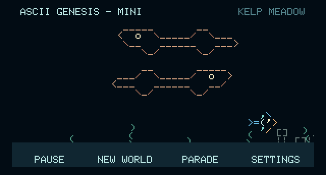

# ASCII Genesis - Mini

A small, touch-controlled ASCII ocean for the **Waveshare ESP32-S3-Touch-LCD-1.47**. The screen runs sideways at **320 × 172**. The ESP32 is built into the display board; no Raspberry Pi is needed.

## With thanks to the projects that started it

ASCII Genesis grew from **[Asciiquarium](https://github.com/cmatsuoka/asciiquarium)**, created by **Kirk Baucom**, with most original ASCII art credited to **Joan Stark** and expanded marine biodiversity by **Claudio Matsuoka**. Their shared work gave this ocean its foundation and much of its character.

**[OpenGhost](https://github.com/xanderchinxyz/OpenGhost)** by **xanderchinxyz and its contributors** inspired the early exploration of a small physical display. Thank you to both projects and the people who made them possible. Read the [full credits and project origins](CREDITS.md).

We call ASCII Genesis an **ocean**: its creatures travel through a scrolling world of changing terrain and habitats.

**This repository is for the Mini only.** The larger Raspberry Pi ocean has its own [repository and instructions](https://github.com/Mikepyt87/ascii-genesis).


Each startup and New World randomizes the opening creatures, directions, positions, and habitat. The parade keeps its original order.

A pocket-sized ocean made from colored text: fish cross the water, bubbles rise, and plants sway above a slowly traveling seabed. Plug the board into USB power and it starts on its own. It runs offline; Wi-Fi is optional for updates.

**Explore it:** [Complete Ocean Library](docs/OCEAN-LIBRARY.md) · [Visual tour](docs/SCREENSHOTS.md) · [About the Mini and Pi comparison](docs/PROJECT.md) · [Version history](CHANGELOG.md)

**v0.1.9** updates the device and guides to use ocean consistently. The release also makes the project’s origins and thanks easier to find here on GitHub.

## Start here

| What you want to do | Follow this guide |
| --- | --- |
| Browse every creature, drawing, color, and behavior | [Mini Ocean Library: all 28 designs in both directions](docs/OCEAN-LIBRARY.md) |
| See the screen and understand the project | [Visual tour](docs/SCREENSHOTS.md) and [project description](docs/PROJECT.md) |
| Put the ocean on a new board | [First installation: download, USB port, flash, and first startup](docs/INSTALL.md) |
| Update an ocean that already works | [Wireless updates and version checks](docs/UPDATES.md) |
| Connect home Wi-Fi or a phone hotspot | [Wi-Fi setup, step by step](docs/WIFI.md) |
| Use Pause, New World, Parade, and Settings | [Touch controls and parade](docs/CONTROLS.md) |
| Fix a blank screen, connection problem, or failed update | [Troubleshooting and USB recovery](docs/TROUBLESHOOTING.md) |
| Preview it or build from source | [Developer setup and checks](docs/DEVELOPMENT.md) |
| Understand the move from the original repository | [Repository transition and existing boards](docs/MIGRATION.md) |
| Report a problem or help improve it | [Contributing and issue information](CONTRIBUTING.md) |

## Required hardware

- **Waveshare ESP32-S3-Touch-LCD-1.47**, including its capacitive touch screen, 16 MB flash, and 8 MB PSRAM. Check the full model name: the non-touch LCD-1.47 is different.
- A USB **data** cable and a computer for the first installation. A charge-only cable will power the screen but cannot install firmware.
- A USB power source for normal use.
- Optional: home Wi-Fi or a phone hotspot operating at **2.4 GHz** for updates.

No microSD card, soldered headers, API key, Raspberry Pi OS, or Pi desktop installer is required. The ocean runs without internet. An SD card does not add RAM and is not used by this firmware.

## What it does

The ocean includes **28 colored creature and vehicle designs**, each facing both directions. Tiny reef fish share the collection with a puffer, ray, eel, squid, octopus, turtle, jellyfish, crab, lobster, shark, whale, yellow submarine, lionfish, and peacock mantis shrimp. The [Ocean Library](docs/OCEAN-LIBRARY.md) includes every drawing, its dimensions, palette, origin, and behavior.

Up to three creatures swim in separate vertical bands, leaving room for their whole drawings and gentle bobbing. In v0.1.7 regular swimmers move at **9–18 pixels per second**, three times the previous range. Plants remain rooted to the seabed as both scroll together at **3.6 pixels per second**. Bubbles rise through the water, and the habitat label changes every 45 seconds. Coral garden adds pink branches; rocky reef and wreck depths add small rock outlines. [Exact scenery and movement rules](docs/OCEAN-LIBRARY.md#habitats-and-scenery).

The layout keeps text and foreground content away from the screen's rounded corners. The Mini is a decorative ocean with static ASCII drawings and simple motion. The larger Pi edition has its own food web, schools, visitors, lighting, and other features; see [the edition comparison](docs/PROJECT.md#mini-and-raspberry-pi-editions).

Tap the water to reveal **Pause · New World · Parade · Settings**. Controls fade after eight seconds. The parade shows all 28 designs in their original order, with up to two in separate bands and their names at the top right. Each crosses in six seconds; the full parade takes **1 minute 45 seconds**. It then returns to the ocean you left. [Full controls guide](docs/CONTROLS.md).



These images come from the Mini browser renderer; they are software previews rather than board photographs. See the [visual tour](docs/SCREENSHOTS.md) for the parade, coral garden, and complete collection.

Source firmware version: **0.1.9**. Use a numbered release from [Releases](https://github.com/Mikepyt87/ascii-genesis-mini/releases); a source-code ZIP is not installable firmware. The release page identifies which version is actually published. [Changes by version](CHANGELOG.md).

## Quick update for an existing board

1. Connect the ocean to home Wi-Fi or a 2.4 GHz hotspot.
2. Tap **Settings → Check for updates**.
3. When offered a newer version, tap **Install** and leave power connected through the restart.
4. Wait at least 30 seconds after the ocean returns, then confirm the version in Settings.

Boards on **v0.1.2 or v0.1.3 need USB recovery first** because those versions cannot follow GitHub's long download addresses. Boards on v0.1.4/v0.1.5 receive the v0.1.6 transition through the old channel; v0.1.6 and later check this repository. See [the transition guide](docs/MIGRATION.md).

## Source layout

| Folder | Contents |
| --- | --- |
| `firmware/` | ESP-IDF 5.5.2 application, display/touch driver, Wi-Fi and updater |
| `preview/` | Local browser simulation; no real passwords or flashing |
| `art/` | Shared-source ASCII drawings, original additions, and artwork license |
| `tools/` | Asset generator, manifest generator, and software checks |
| `docs/` | Installation, Wi-Fi, controls, updates, recovery, and development guides |

## Preview before installing

With Node.js 20 or newer installed, clone or download this repository, open a terminal in its folder, and run:

```text
node preview/serve.mjs
```

Open **http://127.0.0.1:4174** on that computer. The preview includes the ocean, touch controls, and parade, with a labeled simulation of Wi-Fi/update screens. Leave the terminal running while using it; Ctrl+C stops it. It cannot flash or provision a real board. [Complete preview and development instructions](docs/DEVELOPMENT.md).

## Build, checks, and contributions

The actual firmware builds with **ESP-IDF 5.5.2** for ESP32-S3. The JD9853 LCD and AXS5106L touch controller are configured in the supplied source; no separate display-library setup is needed. The browser preview has no npm dependencies. Automated checks cover a simulated hour, creature separation, rounded-corner margins, scenery movement, touch/update policies, the complete parade, generated assets, catalog freshness, and documentation links. GitHub Actions also compiles the device firmware. Hardware behavior still needs a real board.

Use [Development](docs/DEVELOPMENT.md) for exact commands, [Contributing](CONTRIBUTING.md) for changes and reports, and [Maintainer releases](docs/RELEASES.md) for publishing a device update.

## Credits and licenses

ASCII Genesis builds on **Asciiquarium by Kirk Baucom**, with most upstream art credited to **Joan Stark** and expanded biodiversity by **Claudio Matsuoka**. Original project additions include the mantis shrimp and other creatures. **OpenGhost / xanderchinxyz** inspired the early display exploration. See [CREDITS.md](CREDITS.md) and [THIRD-PARTY.md](THIRD-PARTY.md).

The firmware is [GPL-3.0-or-later](LICENSE). Artwork is [GPL-2.0-or-later](art/LICENSE.txt); the display driver and bitmap font retain their own notices.
