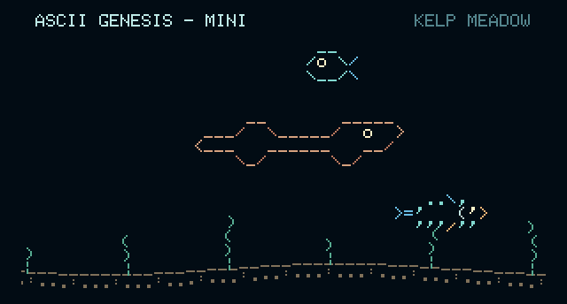

# ASCII Genesis — Mini

A traveling ASCII ocean for **Waveshare ESP32-S3-Touch-LCD-1.47**, displayed sideways at **320 × 172**.

## With thanks to the projects that started it

ASCII Genesis grew from **[Asciiquarium](https://github.com/cmatsuoka/asciiquarium)**, created by **Kirk Baucom**, with most original ASCII art credited to **Joan Stark** and expanded marine biodiversity by **Claudio Matsuoka**. Their shared work gave this ocean its foundation and much of its character.

**[OpenGhost](https://github.com/xanderchinxyz/OpenGhost)** by **xanderchinxyz and its contributors** inspired the early exploration of a small physical display. Thank you to both projects and the people who made them possible. Read the [full credits and project origins](CREDITS.md).

We call ASCII Genesis an **ocean**: its creatures travel through a scrolling world of changing terrain and habitats.

**This repository is the Mini project.** The other editions have separate projects: **[ASCII Genesis — Raspberry Pi](https://github.com/Mikepyt87/ascii-genesis)** and **[ASCII Genesis — Mid](https://github.com/Mikepyt87/ascii-genesis-mid)**. The three projects have different hardware, installers, and update channels.

## Start here

| Your situation | What to do |
| --- | --- |
| Building the Mini ocean for the first time | Follow [Mini installation and first startup](docs/INSTALL.md) from the board check onward |
| Checking the board and USB connection | Follow the [board and USB port checks](docs/INSTALL.md); use the Waveshare touch model listed below |
| Already installed and want new creatures | Connect Wi-Fi, open **Settings → Check for Updates → Install**, and keep power connected; see [wireless updates](docs/UPDATES.md) |
| Want to see the artwork and behavior | Open the [Ocean Library](docs/OCEAN-LIBRARY.md) or [screenshot tour](docs/SCREENSHOTS.md) |
| Have the 4-inch GUITION screen or a Raspberry Pi | Use the [Mid installation guide](https://github.com/Mikepyt87/ascii-genesis-mid/blob/main/INSTALL.md) or [Pi installation guide](https://github.com/Mikepyt87/ascii-genesis/blob/main/raspberry-pi/SETUP.md) for that edition |

## Mini hardware

- Waveshare **ESP32-S3-Touch-LCD-1.47**, with a built-in ESP32-S3, 16 MB flash, and 8 MB PSRAM.
- Integrated 1.47-inch JD9853 display and AXS5106L capacitive touch, used sideways at **320 wide × 172 high**.
- A USB **data** cable and a computer for the first installation.
- A USB power source for normal use.
- Optional: home Wi-Fi or a phone hotspot operating at **2.4 GHz** for updates.

The display and touch controller connect directly to the ESP32 on the board. This is standalone ESP32 firmware; no Raspberry Pi, microSD card, operating-system installation, or API key is needed. Check the full board name: the non-touch LCD-1.47 uses different hardware.

## First software installation on the Mini

Use the [complete guide](docs/INSTALL.md) to check the board and identify its USB port first. Install [Python for Windows](https://www.python.org/downloads/windows/) if needed. Download **ocean-usb.bin** from the newest [numbered Mini release](https://github.com/Mikepyt87/ascii-genesis-mini/releases). Then open **Windows PowerShell in the folder containing that file**, replacing **COM7** with your board's port:

```powershell
py -m venv .flash-tools
.\.flash-tools\Scripts\python.exe -m pip install esptool
.\.flash-tools\Scripts\python.exe -m esptool --chip esp32s3 --port COM7 --baud 460800 write-flash --flash-mode dio --flash-size 16MB --flash-freq 80m 0x0 ocean-usb.bin
```

The ocean starts when the board restarts. Leave power connected for at least **30 seconds after startup**. If the Mini is already installed, use the update instructions instead of flashing over it. [The full guide](docs/INSTALL.md) explains the complete USB image, port selection, first startup, and Linux/macOS installation. It also links to [Wi-Fi setup](docs/WIFI.md), [touch controls](docs/CONTROLS.md), and [troubleshooting](docs/TROUBLESHOOTING.md).

## What the Mini ocean includes

There are **28 colored creature and vehicle designs**, including the peacock mantis shrimp, six changing habitats, rising bubbles, swaying plants, and a scrolling seabed. Up to three creatures swim in separate bands. Startup and New World randomize the opening creatures, directions, positions, and habitat. It runs offline; Wi-Fi is optional for updates.

Tap the water for **Pause · New World · Parade · Settings**. The parade keeps all 28 designs in their original order, with six-second crossings and up to two creatures at a time. A full Mini parade takes **105 seconds (1 minute 45 seconds)**, then returns to the preserved ocean. The full names appear at the top right, with larger, brighter text from v0.1.10. Regular swimmers move at **9–18 pixels per second**, while the seabed scrolls at **3.6 pixels per second**. See the [Ocean Library](docs/OCEAN-LIBRARY.md) and [controls guide](docs/CONTROLS.md) for the full behavior.

Surface stretches bring sailing boats, whales that surface and spout, and an occasional Nessie-like sea monster. Castles and ruins pass along the seabed. Bubbles rise from creatures or the seabed, with no more than two on screen at once. Surface visitors take turns, and the creature parade keeps its own clear view.



The image is a browser preview, not a photograph of the board.

## Updates and source

The Mini updater follows this repository's wireless update channel. Connect home Wi-Fi or a 2.4 GHz hotspot, then use **Settings → Check for Updates → Install**. Keep power connected through the restart and for at least 30 seconds afterward. It checks for releases automatically but waits for you to choose Install. [The update guide](docs/UPDATES.md) covers version checks and recovery.

Current firmware: **v0.1.10**. Use a numbered [release](https://github.com/Mikepyt87/ascii-genesis-mini/releases) for installable firmware; [CHANGELOG.md](CHANGELOG.md) records the changes. Boards on v0.1.2/v0.1.3 need USB recovery first. Boards on v0.1.4/v0.1.5 receive the v0.1.6 transition before checking this repository. See [migration details](docs/MIGRATION.md).

The firmware and board drivers are in `firmware/`; the browser preview is in `preview/`; artwork is in `art/`; generators and checks are in `tools/`. Tests run in GitHub Actions. Use [Development](docs/DEVELOPMENT.md) for the preview and ESP-IDF 5.5.2 build, [the edition comparison](docs/PROJECT.md) for the differences from Pi, [Contributing](CONTRIBUTING.md) to help improve it, and [Maintainer releases](docs/RELEASES.md) for publishing an update.

## Credits

Built on **Asciiquarium by Kirk Baucom**, with most upstream ASCII art credited to **Joan Stark** and expanded biodiversity by **Claudio Matsuoka**. **OpenGhost / xanderchinxyz** inspired the early display exploration. Project additions include the Mini renderer, original creatures, touch controls, Wi-Fi setup, and updater. Read [CREDITS.md](CREDITS.md), [THIRD-PARTY.md](THIRD-PARTY.md), and [LICENSE](LICENSE).

Firmware is GPL-3.0-or-later; artwork is [GPL-2.0-or-later](art/LICENSE.txt). The display driver and bitmap font retain their own notices.
