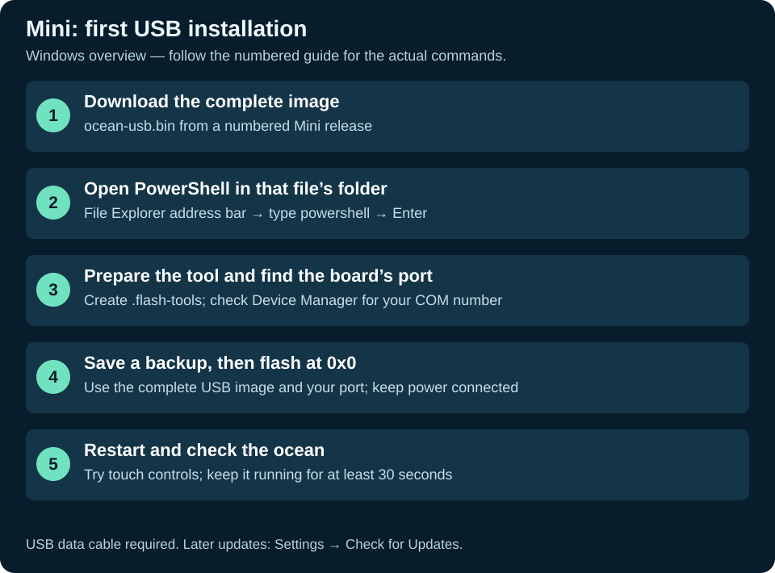

# First installation over USB

Use this guide for a new board, a board running another project, or USB recovery. If your Mini already runs v0.1.4 or later, try [wireless updating](UPDATES.md) first.

## 1. Check the board

The supported model is **Waveshare ESP32-S3-Touch-LCD-1.47**. It has an ESP32-S3, 16 MB flash, 8 MB PSRAM, a JD9853 display, and AXS5106L touch. Use the board sideways: 320 pixels wide, 172 high. Do not use firmware for the non-touch LCD-1.47, another ESP32 screen, or the Raspberry Pi project.

Put the board on a dry, nonconductive surface. Use a known USB data cable connected directly to the computer. The board must stay powered while writing firmware.



## 2. Download the right file

1. Open [ASCII Genesis - Mini releases](https://github.com/Mikepyt87/ascii-genesis-mini/releases).
2. Choose the highest **numbered** release, currently [esp32-147-v0.1.14](https://github.com/Mikepyt87/ascii-genesis-mini/releases/tag/esp32-147-v0.1.14). Release-list order is not always version order.
3. Expand **Assets** if necessary.
4. Download **ocean-usb.bin**. This is the complete first-install image.
5. Create `ASCII-Genesis-Mini` inside your Windows Downloads folder and put the file there. Check that the filename is exactly `ocean-usb.bin`, without a second `.bin` or a download suffix.

| Download | Purpose |
| --- | --- |
| **ocean-usb.bin** | Complete USB image; write at **0x0** |
| `aquarium-usb.bin` | Compatibility filename with the same bytes as `ocean-usb.bin`; use the ocean name in this guide |
| `ascii-genesis-147.bin` | Application-only image for the wireless updater; not a complete USB image |
| `manifest.json` | Version, board ID, download address, size, and checksum for the updater |
| Source code ZIP/tar.gz | Source for developers; cannot be flashed as firmware |
| `esp32-147-stable` | Channel pointer used by the device; choose a numbered release for USB installation |

## 3. Install the flashing tool on Windows

You do **not** need to install the complete ESP-IDF compiler to use a downloaded release.

1. Install Python 3.10 or newer from [python.org](https://www.python.org/downloads/windows/) if it is not installed.
2. Open **Windows PowerShell** from the Start menu.
3. Check Python:

```powershell
py --version
```

If `py` is not recognized, reopen PowerShell after installing Python. If your installation provides `python` instead, use `python --version` to check it and `python -m venv .flash-tools` to create the environment.

4. In File Explorer, open the folder containing the `.bin` file. Click its address bar, type `powershell`, and press Enter. That opens PowerShell in the right folder, even if your Downloads folder is on another drive.
5. Run these commands one line at a time. Do not type the `PS C:\...>` prompt itself:

```powershell
py -m venv .flash-tools
.\.flash-tools\Scripts\python.exe -m pip install esptool==5.6.0
Get-Item .\ocean-usb.bin
```

The last command should list your downloaded file. If it cannot find it, open PowerShell in the correct folder or move the download there.

These commands install the flashing utility in this folder. They do not flash the board. Calling the environment's Python directly avoids changing PowerShell execution policy. Do not upgrade tools inside an existing ESP-IDF environment with this command; use this separate environment instead.

## 4. Find the USB port

1. Connect the board with the data cable.
2. Open **Device Manager → Ports (COM & LPT)**.
3. Note the port that appears, such as **COM7**. Unplug/reconnect once if needed to identify it.
4. Close any serial monitor using that port. In an ESP-IDF monitor, use **Ctrl+]** to exit.

You can also list ports from the same PowerShell window:

```powershell
.\.flash-tools\Scripts\python.exe -m serial.tools.list_ports
```

If there is no new port, try another data cable and direct USB port. Follow [Waveshare's flashing guide](https://docs.waveshare.com/ESP32-S3-Touch-LCD-1.47/Firmware-Flashing) if a driver or download-mode step is needed.

## Optional: keep a factory backup

Before replacing a program you may want back, save all 16 MB of flash from the same PowerShell window, using your actual port:

```powershell
.\.flash-tools\Scripts\python.exe -m esptool --chip esp32s3 --port COM7 read-flash 0x0 0x1000000 factory-backup.bin
```

Wait for successful completion. Keep the backup private; it may contain saved settings. Use a different filename if you already have a backup to keep. To restore it later, run the command below with your actual port. This replaces the ocean and settings with the saved program, preserving the backup’s flash mode and frequency:

```powershell
.\.flash-tools\Scripts\python.exe -m esptool --chip esp32s3 --port COM7 write-flash 0x0 factory-backup.bin
```

## 5. Flash the complete image

Run this from the folder containing `ocean-usb.bin`. **Replace COM7 with the port you found.**

```powershell
.\.flash-tools\Scripts\python.exe -m esptool --chip esp32s3 --port COM7 --baud 460800 write-flash --flash-mode dio --flash-size 16MB --flash-freq 80m 0x0 ocean-usb.bin
```

The offset **0x0** is correct only for the complete `ocean-usb.bin` image. Do not substitute the application-only file. A full merged USB image can overwrite saved Wi-Fi settings; be ready to enter them again. Wireless updates preserve the saved settings.

Wait for **Hash of data verified** and completion. Do not disconnect power while the progress bar is moving. If connection fails, hold **BOOT**, press and release **RESET**, then release BOOT and retry. The USB port may change in download mode; check it again.

If writing repeatedly fails, try a shorter data cable or replace `460800` with `115200`.

If the board remains in download mode after a successful flash, press RESET once without holding BOOT.

## 6. Verify the first startup

1. Confirm that the ocean picture appears sideways at the full 320 × 172 resolution.
2. Tap the water once and lift your finger. Confirm four buttons appear.
3. Tap Pause, then Resume. Try New World.
4. Tap Parade. A creature should enter from the left; the top-left counter shows its place in the collection. Tap Return to stop early.
5. Open Settings and confirm the release version.
6. Leave it powered for **at least 30 seconds after startup** before unplugging or restarting. New firmware is accepted after its display/touch/render loop succeeds for that period.

Wi-Fi is optional. Continue with [Wi-Fi and phone hotspots](WIFI.md) if you want updates. If the screen is blank, touch does not respond, or the device keeps rebooting, use [Troubleshooting](TROUBLESHOOTING.md).

## Linux or macOS

Download the same complete image. Open Terminal and change into the folder containing `ocean-usb.bin` (for example, `cd ~/Downloads/ASCII-Genesis-Mini`). Install Python 3.10+ and create an environment there:

```bash
python3 -m venv .flash-tools
.flash-tools/bin/python -m pip install esptool==5.6.0
.flash-tools/bin/python -m serial.tools.list_ports
.flash-tools/bin/python -m esptool --chip esp32s3 --port /dev/ttyACM0 --baud 460800 write-flash --flash-mode dio --flash-size 16MB --flash-freq 80m 0x0 ocean-usb.bin
```

Replace `/dev/ttyACM0` with the actual listed port. On macOS it may start with `/dev/cu.usbmodem`. On Linux your account may need serial-port group access; follow your distribution's instructions, then sign out/in. Do not guess the port or image offset.

References: [Espressif esptool installation](https://docs.espressif.com/projects/esptool/en/latest/esp32s3/installation.html), [flashing firmware](https://docs.espressif.com/projects/esptool/en/latest/esp32s3/esptool/flashing-firmware.html), [board documentation](https://docs.waveshare.com/ESP32-S3-Touch-LCD-1.47).
