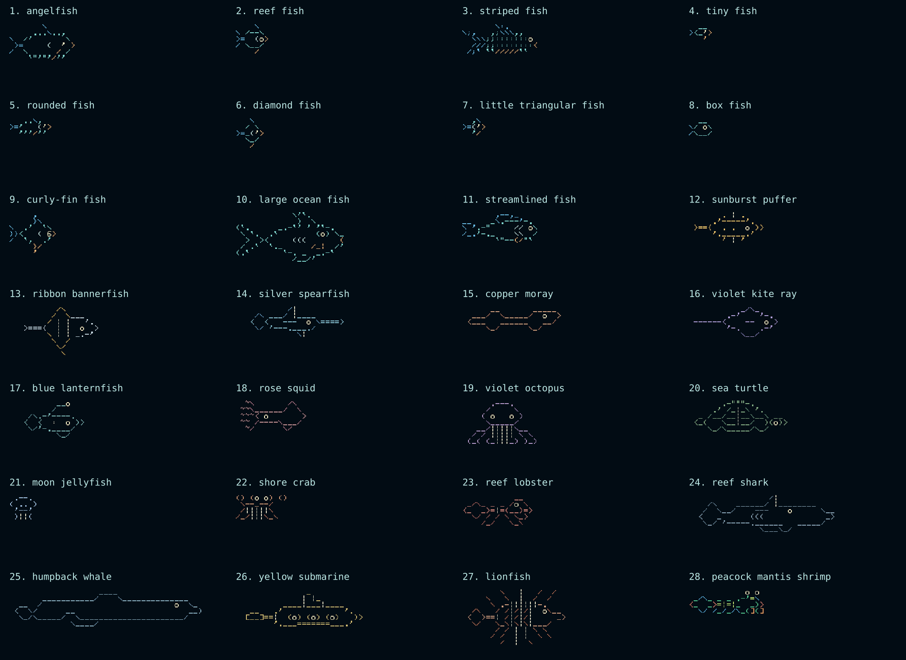

# Mini Ocean Library

The complete artwork and behavior reference for **ASCII Genesis - Mini**, the 320 × 172 ESP32 ocean. This page describes the Mini’s implementation. The [Raspberry Pi library](https://github.com/Mikepyt87/ascii-genesis/blob/main/docs/OCEAN-LIBRARY.md) describes a different program.

There are **31 creature and vehicle designs**, with a left-facing and right-facing drawing for each: **62 sprites**. The yellow submarine is included in that total. Every drawing below comes directly from the bundled artwork, including its spaces, color masks, and dimensions.

The surface boat, spouting whale, two-pose sea monster, castles, and ruins use separate drawings outside this regular collection. See the [illustrated surface scene guide](SURFACE-SCENES.md) and [balanced creature proportions](CREATURE-SIZES.md).



## Find a design

| Parade number | Design | Drawing size, right-facing | Artwork origin |
| --- | --- | --- | --- |
| 1 | [angelfish](#angelfish) | 14 × 6 characters | Adapted Asciiquarium |
| 2 | [reef fish](#reef-fish) | 7 × 5 characters | Adapted Asciiquarium |
| 3 | [striped fish](#striped-fish) | 16 × 5 characters | Adapted Asciiquarium |
| 4 | [tiny fish](#tiny-fish) | 5 × 3 characters | Adapted Asciiquarium |
| 5 | [rounded fish](#rounded-fish) | 9 × 3 characters | Adapted Asciiquarium |
| 6 | [diamond fish](#diamond-fish) | 6 × 5 characters | Adapted Asciiquarium |
| 7 | [little triangular fish](#little-triangular-fish) | 5 × 3 characters | Adapted Asciiquarium |
| 8 | [box fish](#box-fish) | 5 × 3 characters | Adapted Asciiquarium |
| 9 | [curly-fin fish](#curly-fin-fish) | 10 × 7 characters | Adapted Asciiquarium |
| 10 | [large ocean fish](#large-ocean-fish) | 23 × 8 characters | Adapted Asciiquarium |
| 11 | [streamlined fish](#streamlined-fish) | 16 × 5 characters | Adapted Asciiquarium |
| 12 | [sunburst puffer](#sunburst-puffer) | 16 × 5 characters | ASCII Genesis original |
| 13 | [ribbon bannerfish](#ribbon-bannerfish) | 19 × 8 characters | ASCII Genesis original |
| 14 | [silver spearfish](#silver-spearfish) | 23 × 5 characters | ASCII Genesis original |
| 15 | [copper moray](#copper-moray) | 21 × 4 characters | ASCII Genesis original |
| 16 | [violet kite ray](#violet-kite-ray) | 19 × 5 characters | ASCII Genesis original |
| 17 | [blue lanternfish](#blue-lanternfish) | 16 × 6 characters | ASCII Genesis original |
| 18 | [rose squid](#rose-squid) | 15 × 5 characters | ASCII Genesis original |
| 19 | [violet octopus](#violet-octopus) | 16 × 7 characters | ASCII Genesis original |
| 20 | [sea turtle](#sea-turtle) | 21 × 5 characters | ASCII Genesis original |
| 21 | [moon jellyfish](#moon-jellyfish) | 6 × 4 characters | ASCII Genesis original |
| 22 | [shore crab](#shore-crab) | 11 × 4 characters | ASCII Genesis original |
| 23 | [reef lobster](#reef-lobster) | 15 × 5 characters | ASCII Genesis original |
| 24 | [reef shark](#reef-shark) | 31 × 6 characters | ASCII Genesis original |
| 25 | [humpback whale](#humpback-whale) | 41 × 6 characters | ASCII Genesis original |
| 26 | [yellow submarine](#yellow-submarine) | 27 × 6 characters | ASCII Genesis original |
| 27 | [lionfish](#lionfish) | 22 × 9 characters | ASCII Genesis original |
| 28 | [peacock mantis shrimp](#peacock-mantis-shrimp) | 16 × 4 characters | ASCII Genesis original |
| 29 | [balance angelfish](#balance-angelfish) | 15 × 5 characters | ASCII Genesis original |
| 30 | [steadfast marlin](#steadfast-marlin) | 22 × 5 characters | ASCII Genesis original |
| 31 | [spark wrasse](#spark-wrasse) | 16 × 5 characters | ASCII Genesis original |

## Shared swimming behavior

- Normal swimming uses **9–18 screen pixels per second**, three times the v0.1.6 range. Each arrival receives its own speed and left/right direction. A point would cross the 320-pixel screen in roughly 18–36 seconds; a complete drawing takes longer to enter and leave.
- The seabed and rooted plants travel together at **3.6 pixels per second**. Faster fish do not change camera speed, habitat timing, bubble speed, or the Pi edition.
- There are at most **three normal creatures**. Free swimmers occupy separate vertical bands with a two-pixel bob and four-pixel gap; bottom dwellers reserve the seabed band. A new arrival waits if its full height will not fit.
- New arrivals begin beyond an edge and normally leave after their full drawing clears it. The waterline waits above existing swimmers; it never removes them or moves their lanes. New arrivals use clear bands below the intended surface depth. Edge clipping during entry or departure is expected. Important content is inset from the physical screen’s rounded corners.
- The colored character drawings are static. The renderer translates each drawing; free swimmers have a small vertical bob, while bottom dwellers keep their feet on the terrain. It does not animate individual fins, claws, legs, or tentacles.
- The crab, lobster, octopus, and mantis shrimp use a reserved bottom band and visible-foot terrain contact instead of swimming lanes. They stay grounded during the parade too. The Mini has no hunting, food web, schools, diver visits, local-clock lighting, or AI narration.

## Creature parade

Parade keeps the table’s original order, facing right, with **up to two designs at a time** in separate bands. Each crosses in six seconds; the next enters after three seconds when both drawings fit. Tall neighbors and creatures sharing the bottom lane take turns so nothing overlaps. The full lineup lasts **123 seconds (2 minutes 3 seconds)**. Creature names appear at the top right, on separate lines matching their bands. The normal swimming speed does not control parade speed.

The normal world is held in place, including its random state, then resumes when the parade finishes or you tap Return. Pause freezes the parade too. New World cancels it and starts a fresh ocean. See [Controls](CONTROLS.md) for button behavior.

## Habitats and scenery

The habitat label changes every **45 seconds of running ocean time**, cycling through six labels in 4 minutes 30 seconds. Pausing freezes that clock; a parade holds it in place. These are simple decorative variations, not six separate ecosystems.

| Habitat | What the Mini draws |
| --- | --- |
| Kelp meadow | The shared rolling seabed and swaying plants |
| Rocky reef | The shared scenery plus small rock outlines |
| Open sand | The shared seabed and plants; no separate sand ecosystem |
| Coral garden | The shared scenery with pink branching marks on plants |
| Seagrass bed | The shared seabed and plants; no separate grass simulation |
| Wreck depths | The shared scenery plus rock outlines; no shipwreck sprite or visiting eel |

Ground is made from underscore, dot, and colon characters along a shallow wave. Plants have two to four character rows, sway above their fixed roots, and travel with the same camera as the ground. Bubbles rise from creatures or the seabed, with at most two present and 7–12 seconds between emission attempts. They drift upward at seven pixels per second and disappear at the current waterline. The habitat label does not restrict which designs can arrive.

## Surface visits and landmarks

The journey occasionally rises to a visible waterline, then returns to deeper water. A surface stretch lasts about two minutes in a cycle of four to five minutes. The camera eases into and out of it over twelve seconds. A sailing boat, a surfacing whale with a short animated water spout, and a long-necked sea monster each get a thirty-second crossing window. Only one surface visitor appears at a time. Their order varies with the world seed; the creature parade keeps its original order.

Castles and submerged ruins belong to fixed world coordinates, so they move with the seabed. These new landmarks stay in the bottom third of the screen. They are background scenery rather than extra swimmers. The sea monster uses two poses adapted from the original Asciiquarium drawing; the compact boat, whale, spout, castle, and ruins are ASCII Genesis additions. See the repository credits for authors and licenses.

The surface visitors and landmarks are separate from the 31 regular creature and vehicle designs. They do not add entries to the parade. Pause freezes the scene; New World starts a new journey. During the parade, the surface scenes are hidden and their normal-world clock is held, then resumes afterward.

The new castles and ruins stay in the bottom third; the Mini uses compact drawings so they do not crowd the open water. Surface visitors, scenery, and ordinary bubbles are hidden during the parade. They do not change the 31-design lineup. See the [illustrated surface scenes guide](SURFACE-SCENES.md).

## Creature drawings

The sizes below are **columns × rows of characters**. The bitmap cell is 6 × 8 pixels; a glyph itself is up to five pixels wide. Colors are the actual palette values used by the renderer, not a claim about the real animal’s biology.

### angelfish

A broad body with a swept upper fin, forked tail, and small eye near the nose.

- **Parade position:** 1 of 31.
- **Drawing size:** right 14 × 6; left 14 × 6 characters.
- **Palette:** `#81d8d0`, `#69bde5`, `#f2b677`, `#fff4c9`, `#c6e8e4`.
- **Origin:** Adapted Asciiquarium artwork; see [credits](../CREDITS.md).
- **Motion:** [Shared swimming behavior](#shared-swimming-behavior); no individual hunting or feeding rules.

Facing right:

```text
       \
     ...\..,
\  /'       \
 >=     (  ' >
/  \      / /
    `"'"'/''
```

Facing left:

```text
      /
  ,../...
 /       '\  /
< '  )     =<
 \ \      /  \
  `'\'"'"'
```

### reef fish

A compact reef-fish outline with pointed fins and a round eye. Its short silhouette leaves plenty of open water around it.

- **Parade position:** 2 of 31.
- **Drawing size:** right 7 × 5; left 7 × 5 characters.
- **Palette:** `#81d8d0`, `#69bde5`, `#f2b677`, `#fff4c9`, `#c6e8e4`.
- **Origin:** Adapted Asciiquarium artwork; see [credits](../CREDITS.md).
- **Motion:** [Shared swimming behavior](#shared-swimming-behavior); no individual hunting or feeding rules.

Facing right:

```text
    \
\ /--\
>=  (o>
/ \__/
    /
```

Facing left:

```text
  /
 /--\ /
<o)  =<
 \__/ \
  \
```

### striped fish

Dense colon markings fill a long body, surrounded by layered slash fins and a forked tail.

- **Parade position:** 3 of 31.
- **Drawing size:** right 16 × 5; left 16 × 5 characters.
- **Palette:** `#81d8d0`, `#69bde5`, `#f2b677`, `#fff4c9`, `#c6e8e4`.
- **Origin:** Adapted Asciiquarium artwork; see [credits](../CREDITS.md).
- **Motion:** [Shared swimming behavior](#shared-swimming-behavior); no individual hunting or feeding rules.

Facing right:

```text
       \:.
\;,   ,;\\\,,
  \\\;;:::::::o
  ///;;::::::::<
 /;` ``/////``
```

Facing left:

```text
      .:/
   ,,///;,   ,;/
 o:::::::;;///
>::::::::;;\\\
  ''\\\\\'' ';\
```

### tiny fish

A three-line fish with a little outlined body and a crossed tail. It is one of the smallest drawings in the collection.

- **Parade position:** 4 of 31.
- **Drawing size:** right 5 × 3; left 5 × 3 characters.
- **Palette:** `#81d8d0`, `#69bde5`, `#f2b677`, `#fff4c9`, `#c6e8e4`.
- **Origin:** Adapted Asciiquarium artwork; see [credits](../CREDITS.md).
- **Motion:** [Shared swimming behavior](#shared-swimming-behavior); no individual hunting or feeding rules.

Facing right:

```text
  __
><_'>
   '
```

Facing left:

```text
 __
<'_><
 `
```

### rounded fish

A low, rounded body with short fins and a small forked tail.

- **Parade position:** 5 of 31.
- **Drawing size:** right 9 × 3; left 9 × 3 characters.
- **Palette:** `#81d8d0`, `#69bde5`, `#f2b677`, `#fff4c9`, `#c6e8e4`.
- **Origin:** Adapted Asciiquarium artwork; see [credits](../CREDITS.md).
- **Motion:** [Shared swimming behavior](#shared-swimming-behavior); no individual hunting or feeding rules.

Facing right:

```text
   ..\,
>='   ('>
  '''/''
```

Facing left:

```text
  ,/..
<')   `=<
 ``\```
```

### diamond fish

A broad diamond-shaped silhouette with tall fins above and below the body.

- **Parade position:** 6 of 31.
- **Drawing size:** right 6 × 5; left 6 × 5 characters.
- **Palette:** `#81d8d0`, `#69bde5`, `#f2b677`, `#fff4c9`, `#c6e8e4`.
- **Origin:** Adapted Asciiquarium artwork; see [credits](../CREDITS.md).
- **Motion:** [Shared swimming behavior](#shared-swimming-behavior); no individual hunting or feeding rules.

Facing right:

```text
   \
  / \
>=_('>
  \_/
   /
```

Facing left:

```text
  /
 / \
<')_=<
 \_/
  \
```

### little triangular fish

A small angular fish made from a few sloping lines. The pointed outline contrasts with the rounder reef fish.

- **Parade position:** 7 of 31.
- **Drawing size:** right 5 × 3; left 5 × 3 characters.
- **Palette:** `#81d8d0`, `#69bde5`, `#f2b677`, `#fff4c9`, `#c6e8e4`.
- **Origin:** Adapted Asciiquarium artwork; see [credits](../CREDITS.md).
- **Motion:** [Shared swimming behavior](#shared-swimming-behavior); no individual hunting or feeding rules.

Facing right:

```text
  ,\
>=('>
  '/
```

Facing left:

```text
 /,
<')=<
 \`
```

### box fish

A compact, box-shaped body with a blunt face and small fins.

- **Parade position:** 8 of 31.
- **Drawing size:** right 5 × 3; left 5 × 3 characters.
- **Palette:** `#81d8d0`, `#69bde5`, `#f2b677`, `#fff4c9`, `#c6e8e4`.
- **Origin:** Adapted Asciiquarium artwork; see [credits](../CREDITS.md).
- **Motion:** [Shared swimming behavior](#shared-swimming-behavior); no individual hunting or feeding rules.

Facing right:

```text
  __
\/ o\
/\__/
```

Facing left:

```text
 __
/o \/
\__/\
```

### curly-fin fish

An ornate fish with curled fin details and a larger outline than the tiny reef drawings.

- **Parade position:** 9 of 31.
- **Drawing size:** right 10 × 7; left 10 × 7 characters.
- **Palette:** `#81d8d0`, `#69bde5`, `#f2b677`, `#fff4c9`, `#c6e8e4`.
- **Origin:** Adapted Asciiquarium artwork; see [credits](../CREDITS.md).
- **Motion:** [Shared swimming behavior](#shared-swimming-behavior); no individual hunting or feeding rules.

Facing right:

```text
     ,
     }\
\  .'  `\
}}<   ( 6>
/  `,  .'
     }/
     '
```

Facing left:

```text
    ,
   /{
 /'  `.  /
<6 )   >{{
 `.  ,'  \
   \{
    `
```

### large ocean fish

A long, roomy ocean-fish drawing with an extended body and prominent fins.

- **Parade position:** 10 of 31.
- **Drawing size:** right 23 × 8; left 23 × 8 characters.
- **Palette:** `#81d8d0`, `#69bde5`, `#f2b677`, `#fff4c9`, `#c6e8e4`.
- **Origin:** Adapted Asciiquarium artwork; see [credits](../CREDITS.md).
- **Motion:** [Shared swimming behavior](#shared-swimming-behavior); no individual hunting or feeding rules.

Facing right:

```text
            \'`.
             )  \
(`.      _.-`' ' '`-.
 \ `.  .`        (o) \_
  >  ><     (((       (
 / .`  `._      /_|  /'
(.`       `-. _  _.-`
            /__/'
```

Facing left:

```text
       .'`/
      /  (
  .-'` ` `'-._      .')
_/ (o)        '.  .' /
)       )))     ><  <
`\  |_\      _.'  '. \
  '-._  _ .-'       '.)
      `\__\
```

### streamlined fish

A narrow, pointed silhouette that suggests a fast cruising fish.

- **Parade position:** 11 of 31.
- **Drawing size:** right 16 × 5; left 16 × 5 characters.
- **Palette:** `#81d8d0`, `#69bde5`, `#f2b677`, `#fff4c9`, `#c6e8e4`.
- **Origin:** Adapted Asciiquarium artwork; see [credits](../CREDITS.md).
- **Motion:** [Shared swimming behavior](#shared-swimming-behavior); no individual hunting or feeding rules.

Facing right:

```text
       ,--,_
__    _\.---'-.
\ '.-"     // o\
/_.'-._    \\  /
       `"--(/"`
```

Facing left:

```text
    _,--,
 .-'---./_    __
/o \\     "-.' /
\  //    _.-'._\
 `"\)--"`
```

### sunburst puffer

A round golden puffer with little spikes above and below its body. Warm fins frame the pale eye.

- **Parade position:** 12 of 31.
- **Drawing size:** right 16 × 5; left 16 × 5 characters.
- **Palette:** `#edc46b`, `#cf9558`, `#fff1c8`, `#e4dfc5`.
- **Origin:** Original ASCII Genesis drawing in [original-fish.mjs](../art/original-fish.mjs).
- **Motion:** [Shared swimming behavior](#shared-swimming-behavior); no individual hunting or feeding rules.

Facing right:

```text
       . | .    
     .'-----'.  
 >=={  . .  o )>
     '._____.'  
       ' | '    
```

Facing left:

```text
    . | .       
  .'-----'.     
<( o  . .  }==< 
  '._____.'     
    ' | '       
```

### ribbon bannerfish

A pale bannerfish with vertical markings and a tall trailing fin. It uses eight character rows, making it one of the taller designs.

- **Parade position:** 13 of 31.
- **Drawing size:** right 19 × 8; left 19 × 8 characters.
- **Palette:** `#c9dbe4`, `#e2b961`, `#fff1c8`, `#e4dfc5`.
- **Origin:** Original ASCII Genesis drawing in [original-fish.mjs](../art/original-fish.mjs).
- **Motion:** [Shared swimming behavior](#shared-swimming-behavior); no individual hunting or feeding rules.

Facing right:

```text
          /\       
         /  \___   
        / | |   '. 
   >==={  | |  o  >
        \ | | _.-' 
         \  /      
          \/       
           \       
```

Facing left:

```text
       /\          
   ___/  \         
 .'   | | \        
<  o  | |  }===<   
 '-._ | | /        
      \  /         
       \/          
       /           
```

### silver spearfish

A silver-blue hunter-shaped fish with a long pointed bill. In the Mini it cruises like the other designs; it does not hunt.

- **Parade position:** 14 of 31.
- **Drawing size:** right 23 × 5; left 23 × 5 characters.
- **Palette:** `#8fcbdc`, `#659abf`, `#fff1c8`, `#e4dfc5`.
- **Origin:** Original ASCII Genesis drawing in [original-fish.mjs](../art/original-fish.mjs).
- **Motion:** [Shared swimming behavior](#shared-swimming-behavior); no individual hunting or feeding rules.

Facing right:

```text
           /|          
    /\ ___/ |____      
   <  <   ---  o \====>
    \/ '---.___./      
             \|        
```

Facing left:

```text
          |\           
      ____| \___ /\    
<====/ o  ---   >  >   
      \.___.---' \/    
        |/             
```

### copper moray

A copper-colored eel with an elongated, gently bent body. It is a regular swimmer here rather than an eel peeking from scenery.

- **Parade position:** 15 of 31.
- **Drawing size:** right 21 × 4; left 21 × 4 characters.
- **Palette:** `#d5a17e`, `#bb795e`, `#fff1c8`, `#e4dfc5`.
- **Origin:** Original ASCII Genesis drawing in [original-fish.mjs](../art/original-fish.mjs).
- **Motion:** [Shared swimming behavior](#shared-swimming-behavior); no individual hunting or feeding rules.

Facing right:

```text
      __       _____ 
  ___/  \_____/  o  >
 <___   ______   __/ 
     \_/      \_/    
```

Facing left:

```text
 _____       __      
<  o  \_____/  \___  
 \__   ______   ___> 
    \_/      \_/     
```

### violet kite ray

A violet ray with broad wings, a narrow tail, and a small eye. Its drawing glides sideways using the shared swimming motion.

- **Parade position:** 16 of 31.
- **Drawing size:** right 19 × 5; left 19 × 5 characters.
- **Palette:** `#b2a0da`, `#857fb8`, `#fff1c8`, `#e4dfc5`.
- **Origin:** Original ASCII Genesis drawing in [original-fish.mjs](../art/original-fish.mjs).
- **Motion:** [Shared swimming behavior](#shared-swimming-behavior); no individual hunting or feeding rules.

Facing right:

```text
           _/\_    
        .-'    '-. 
 ------<    --  o >
        '-.    .-' 
           \__/    
```

Facing left:

```text
    _/\_           
 .-'    '-.        
< o  --    >------ 
 '-.    .-'        
    \__/           
```

### blue lanternfish

A blue-green fish with a light-like stalk above its head and a pale eye. The lure is part of the static artwork.

- **Parade position:** 17 of 31.
- **Drawing size:** right 16 × 6; left 16 × 6 characters.
- **Palette:** `#7fbbb9`, `#63989e`, `#fff1c8`, `#e4dfc5`.
- **Origin:** Original ASCII Genesis drawing in [original-fish.mjs](../art/original-fish.mjs).
- **Motion:** [Shared swimming behavior](#shared-swimming-behavior); no individual hunting or feeding rules.

Facing right:

```text
          __o   
         /      
    /\.-'----.  
   <  <  :  o )>
    \/'-.____/  
          \_/   
```

Facing left:

```text
   o__          
      \         
  .----'-./\    
<( o  :  >  >   
  \____.-'\/    
   \_/          
```

### rose squid

A rose-colored squid with a pointed mantle and tentacles trailing behind. Its whole drawing moves together.

- **Parade position:** 18 of 31.
- **Drawing size:** right 15 × 5; left 15 × 5 characters.
- **Palette:** `#d39b9e`, `#b87b8c`, `#fff1c8`, `#e4dfc5`.
- **Origin:** Original ASCII Genesis drawing in [original-fish.mjs](../art/original-fish.mjs).
- **Motion:** [Shared swimming behavior](#shared-swimming-behavior); no individual hunting or feeding rules.

Facing right:

```text
  ~\       /\  
 ~~\______/  \ 
 ~~~< o       >
 ~~ /----\___/ 
  ~/      \/   
```

Facing left:

```text
  /\       /~  
 /  \______/~~ 
<       o >~~~ 
 \___/----\ ~~ 
   \/      \~  
```

### violet octopus

A violet octopus with two eyes and curling arms below a rounded head. It follows the scrolling seabed with its arms grounded and no swimming bob.

- **Parade position:** 19 of 31.
- **Drawing size:** right 16 × 7; left 16 × 7 characters.
- **Palette:** `#ba9dce`, `#997caf`, `#fff1c8`, `#e4dfc5`.
- **Origin:** Original ASCII Genesis drawing in [original-fish.mjs](../art/original-fish.mjs).
- **Motion:** [Shared swimming behavior](#shared-swimming-behavior); no individual hunting or feeding rules.

Facing right:

```text
      .---.     
     /     \    
    ( o   o )   
     \_____/    
   __/|||||\__  
  / / ||||| \ \ 
 (_( (_|||_) )_)
```

Facing left:

```text
     .---.      
    /     \     
   ( o   o )    
    \_____/     
  __/|||||\__   
 / / ||||| \ \  
(_( (_|||_) )_) 
```

### sea turtle

A green turtle with a patterned shell, four flippers, and a small head. The shell markings use the artwork color masks.

- **Parade position:** 20 of 31.
- **Drawing size:** right 21 × 5; left 21 × 5 characters.
- **Palette:** `#8bb58a`, `#66957b`, `#fff1c8`, `#e4dfc5`.
- **Origin:** Original ASCII Genesis drawing in [original-fish.mjs](../art/original-fish.mjs).
- **Motion:** [Shared swimming behavior](#shared-swimming-behavior); no individual hunting or feeding rules.

Facing right:

```text
       .-"""-.       
     .' /_|_\ '.     
  _ /__/__|__\__\ __ 
 <_(   \__|__/  )(o)>
    \_/\_____/\_/    
```

Facing left:

```text
       .-"""-.       
     .' /_|_\ '.     
 __ /__/__|__\__\ _  
<(o)(  \__|__/   )_> 
    \_/\_____/\_/    
```

### moon jellyfish

A pale jellyfish with a rounded bell and trailing tentacles. The Mini moves the complete drawing sideways with a gentle bob; it has no separate pulse animation.

- **Parade position:** 21 of 31.
- **Drawing size:** right 6 × 4; left 6 × 4 characters.
- **Palette:** `#a8c9e8`, `#8e9fc9`, `#fff1c8`, `#e4dfc5`.
- **Origin:** Original ASCII Genesis drawing in [original-fish.mjs](../art/original-fish.mjs).
- **Motion:** [Shared swimming behavior](#shared-swimming-behavior); no individual hunting or feeding rules.

Facing right:

```text
 .--. 
( .. )
 '--' 
 )||( 
```

Facing left:

```text
 .--. 
( .. )
 '--' 
 )||( 
```

### shore crab

A small shore crab with claws and low legs. Its visible feet follow the scrolling floor without swimming bob, including during the parade.

- **Parade position:** 22 of 31.
- **Drawing size:** right 11 × 4; left 11 × 4 characters.
- **Palette:** `#d69a76`, `#b87359`, `#fff1c8`, `#e4dfc5`.
- **Origin:** Original ASCII Genesis drawing in [original-fish.mjs](../art/original-fish.mjs).
- **Motion:** [Shared swimming behavior](#shared-swimming-behavior); no individual hunting or feeding rules.

Facing right:

```text
() (o o) ()
 \--_--/   
 /|||||\   
/_/|||\_\  
```

Facing left:

```text
() (o o) ()
   \--_--/ 
   /|||||\ 
  /_/|||\_\
```

### reef lobster

A reef lobster with an extended body, legs, and claws. Like the crab, it follows the seabed in the ordinary ocean and parade.

- **Parade position:** 23 of 31.
- **Drawing size:** right 15 × 5; left 15 × 5 characters.
- **Palette:** `#cf8175`, `#a96159`, `#fff1c8`, `#e4dfc5`.
- **Origin:** Original ASCII Genesis drawing in [original-fish.mjs](../art/original-fish.mjs).
- **Motion:** [Shared swimming behavior](#shared-swimming-behavior); no individual hunting or feeding rules.

Facing right:

```text
           __  
 _/\_ _ _ /o \ 
<_  _>=|=(__)=>
  \/ / / \ \_> 
    /_/   \_\  
```

Facing left:

```text
  __           
 / o\ _ _ _/\_ 
<=(__)=|=<_  _>
 <_/ / \ \ \/  
  /_/   \_\    
```

### reef shark

A shark silhouette with a high dorsal fin, pointed nose, and forked tail. It is decorative here and never eats other fish.

- **Parade position:** 24 of 31.
- **Drawing size:** right 31 × 6; left 31 × 6 characters.
- **Palette:** `#91adbf`, `#688598`, `#fff1c8`, `#e4dfc5`.
- **Origin:** Original ASCII Genesis drawing in [original-fish.mjs](../art/original-fish.mjs).
- **Motion:** [Shared swimming behavior](#shared-swimming-behavior); no individual hunting or feeding rules.

Facing right:

```text
                 /|            
    /\    ______/ |________    
   /  \__/    ---    o      \__
  <   _      (((             _>
   \_/ '-----.______   _____/  
               \___\_/         
```

Facing left:

```text
            |\                 
    ________| \______    /\    
__/      o    ---    \__/  \   
<_             )))      _   >  
  \_____   ______.-----' \_/   
         \_/___/               
```

### humpback whale

A broad whale drawing with flippers and a long back. It uses the same lane-spacing rules as the smaller designs.

- **Parade position:** 25 of 31.
- **Drawing size:** right 41 × 6; left 41 × 6 characters.
- **Palette:** `#91b8c9`, `#6e91aa`, `#fff1c8`, `#e4dfc5`.
- **Origin:** Original ASCII Genesis drawing in [original-fish.mjs](../art/original-fish.mjs).
- **Motion:** [Shared swimming behavior](#shared-swimming-behavior); no individual hunting or feeding rules.

Facing right:

```text
                   ____                  
       ___________/    \______________   
  __  /                            o  \_ 
 <  \/      __                        __)
  \_/\_____/  \______________________/   
             \____/                      
```

Facing left:

```text
                  ____                   
   ______________/    \___________       
 _/  o                            \  __  
(__                        __      \/  > 
   \______________________/  \_____/\_/  
                      \____/             
```

### yellow submarine

A yellow submarine with a raised periscope and hull details. It is the collection’s decorative vehicle, not an animal.

- **Parade position:** 26 of 31.
- **Drawing size:** right 27 × 6; left 27 × 6 characters.
- **Palette:** `#d3bc72`, `#aa9461`, `#fff1c8`, `#e4dfc5`.
- **Origin:** Original ASCII Genesis drawing in [original-fish.mjs](../art/original-fish.mjs).
- **Motion:** [Shared swimming behavior](#shared-swimming-behavior); no individual hunting or feeding rules.

Facing right:

```text
               _           
              | |_         
          ____|___|____    
   __   .'             '.  
  [__]==|  (o) (o) (o)   )>
        '.___=======___.'  
```

Facing left:

```text
           _               
         _| |              
    ____|___|____          
  .'             '.   __   
<(   (o) (o) (o)  |==[__]  
  '.___=======___.'        
```

### lionfish

A copper-toned lionfish with pale stripes and spread-out spines. The fins are drawn into the sprite rather than animated separately.

- **Parade position:** 27 of 31.
- **Drawing size:** right 22 × 9; left 22 × 9 characters.
- **Palette:** `#d6a080`, `#b96f53`, `#fff1c8`, `#e4dfc5`.
- **Origin:** Original ASCII Genesis drawing in [original-fish.mjs](../art/original-fish.mjs).
- **Motion:** [Shared swimming behavior](#shared-swimming-behavior); no individual hunting or feeding rules.

Facing right:

```text
        \   |   /  /  
     \   \  |  /  /   
      \ .-||||||-.    
  /\   / /|/|/|  o\__ 
 <  >==| /|/|/|     _>
  \/   \_\|\|\|___/   
       / / | | \ \    
      / /  | |  \ \   
        /  |  \       
```

Facing left:

```text
  \  \   |   /        
   \  \  |  /   /     
    .-||||||-. /      
 __/o  |\|\|\ \   /\  
<_     |\|\|\ |==<  > 
   \___|/|/|/_/   \/  
    / / | | \ \       
   / /  | |  \ \      
       /  |  \        
```

### peacock mantis shrimp

A peacock mantis shrimp with raised eyes, a green body, blue legs, and orange striking clubs. Its feet follow the seabed without swimming bob; it does not punch, hunt, or dig a burrow.

- **Parade position:** 28 of 31.
- **Drawing size:** right 16 × 4; left 16 × 4 characters.
- **Palette:** `#54c992`, `#59aedd`, `#f4a365`, `#fff1c8`, `#ed8875`, `#b6d96f`.
- **Origin:** Original ASCII Genesis drawing in [original-fish.mjs](../art/original-fish.mjs).
- **Motion:** [Shared swimming behavior](#shared-swimming-behavior); no individual hunting or feeding rules.

Facing right:

```text
            o o 
 _/\_ _ _ .-'=\ 
<_  _>=|=|_  _)>
  \/ /_/_/\_(](]
```

Facing left:

```text
 o o            
 /='-. _ _ _/\_ 
<(_  _|=|=<_  _>
[)[)_/\_\_\ \/  
```

### balance angelfish

A teal angelfish with balanced, wing-shaped fins. Its entrance sends out a soft ring of teal and pale-green sparks.

- **Parade position:** 29 of 31.
- **Drawing size:** right 15 × 5; left 15 × 5 characters.
- **Palette:** `#75d8ca`, `#72a8d4`, `#fff1c8`, `#e4dfc5`.
- **Origin:** Original ASCII Genesis drawing in [original-fish.mjs](../art/original-fish.mjs).
- **Motion:** [Shared swimming behavior](#shared-swimming-behavior); no individual hunting or feeding rules.

Facing right:

```text
         /|    
    /\ .' |__  
   <  >| :  o)>
    \/ '. |--' 
         \|    
```

Facing left:

```text
    |\         
  __| '. /\    
<(o  : |<  >   
 '--| .' \/    
    |/         
```

### steadfast marlin

A blue marlin with a long bill, gold fins, and carefully spaced body stripes. A gold fan of sparks marks its entrance.

- **Parade position:** 30 of 31.
- **Drawing size:** right 22 × 5; left 22 × 5 characters.
- **Palette:** `#79b9e5`, `#dfb96c`, `#fff1c8`, `#e4dfc5`.
- **Origin:** Original ASCII Genesis drawing in [original-fish.mjs](../art/original-fish.mjs).
- **Motion:** [Shared swimming behavior](#shared-swimming-behavior); no individual hunting or feeding rules.

Facing right:

```text
           /|         
   /\ ____/ |___      
  <  <  ===   o \====>
   \/ '---.___./      
           \|         
```

Facing left:

```text
         |\           
      ___| \____ /\   
<====/ o   ===  >  >  
      \.___.---' \/   
         |/           
```

### spark wrasse

An orange wrasse with violet fins and diagonal markings. Violet and orange sparks spiral outward when it enters.

- **Parade position:** 31 of 31.
- **Drawing size:** right 16 × 5; left 16 × 5 characters.
- **Palette:** `#eeab70`, `#b79ae0`, `#fff1c8`, `#e4dfc5`.
- **Origin:** Original ASCII Genesis drawing in [original-fish.mjs](../art/original-fish.mjs).
- **Motion:** [Shared swimming behavior](#shared-swimming-behavior); no individual hunting or feeding rules.

Facing right:

```text
       .-^^^^-. 
   /\ / / /  o\ 
  <  >|/ / /   >
   \/ '.___..-' 
         \_/    
```

Facing left:

```text
 .-^^^^-.       
 /o  \ \ \ /\   
<   \ \ \|<  >  
 '-..___.' \/   
    \_/         
```

## Sources and maintenance

Eleven designs adapt Asciiquarium and seventeen are original ASCII Genesis additions. Preserve the upstream authors’ credits and the [artwork license](../art/LICENSE.txt). See [CREDITS.md](../CREDITS.md) and [THIRD-PARTY.md](../THIRD-PARTY.md).

The artwork source is in [art/](../art/); the browser renderer is [ocean.js](../preview/ocean.js), and the device renderer is [main.c](../firmware/main/main.c). This library and its SVG illustrations are generated by [build-library.mjs](../tools/build-library.mjs). Change descriptions there, then run `node tools/build-library.mjs`. CI checks for stale catalog material. SVG illustrations use the actual preview renderer and bitmap font, with the [Adafruit font notice](../preview/FONT-LICENSE.txt). They are software previews, not photographs or radio/touch emulation.
