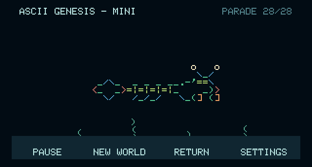
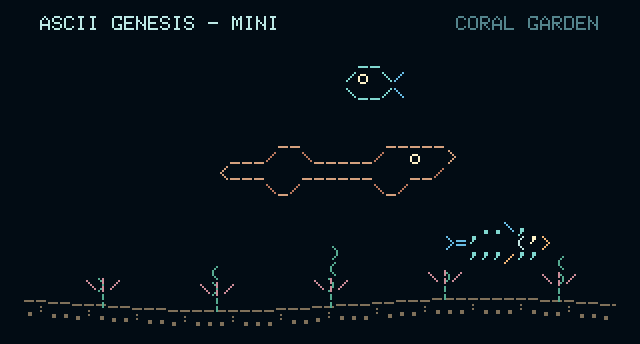

# Mini visual tour

These are generated illustrations from the Mini’s actual browser renderer at **320 × 172**, enlarged with sharp pixels for readability. They use the bundled bitmap font and colored artwork. They are software previews, not board photographs; the browser cannot reproduce physical LCD color, brightness, touch, Wi-Fi, or flash behavior.

## The everyday ocean

This illustration shows one selected scene. Real startup and New World randomize the creatures, directions, positions, and habitat. They leave the scene and are replaced by randomly selected designs. Regular swimmers move at **9–18 pixels per second** in current firmware. The seabed still scrolls at 3.6 pixels per second, with plants anchored to the same ground.

The screen keeps a margin around the rounded corners. You may see creatures partly outside the edges as they arrive or leave; that is part of their crossing. The [Ocean Library](OCEAN-LIBRARY.md) shows the complete drawings.

## Four touch controls

Tap the water, lift your finger, then tap a button. Controls normally hide after eight seconds; while paused they stay visible. Pause freezes the scene, New World starts again, Parade starts the collection showcase, and Settings opens Wi-Fi and updates. [Complete controls](CONTROLS.md).

## The mantis shrimp and parade

This illustration holds the parade at its final design, the peacock mantis shrimp. Its green body, blue legs, and orange striking clubs are separate colors in the drawing. Its visible feet follow the seabed, including during the parade; there is no claw strike animation.

All 28 designs keep their original order, with six-second crossings and up to two creatures in separate bands. Their names appear at the top right. A full parade lasts **1 minute 54 seconds**. Tall neighbors wait for enough room. Return resumes your preserved ocean.

## Coral garden

The habitat label rotates through six names every 45 seconds of normal running time. Coral garden adds pink branch marks; rocky reef and wreck depths add little rock outlines. Other labels share the same rolling ground and plants. The Mini does not include the Pi’s large wreck, discoveries, food web, or day/night cycle. [Exact scenery reference](OCEAN-LIBRARY.md#habitats-and-scenery).

## Surface visitors and landmarks

The current ocean also includes sailing boats, surfacing and spouting whales, a two-pose sea monster, castles, and submerged ruins. New landmarks stay in the bottom third. At most two ordinary bubbles rise at once. View the [current scene illustrations and behavior guide](SURFACE-SCENES.md); these visitors are separate from the 28-design parade.

## The complete collection

The collection contains eleven adapted Asciiquarium designs and seventeen original ASCII Genesis additions. Both directions, exact dimensions, palettes, origins, and Mini behavior are documented for every design in the [Ocean Library](OCEAN-LIBRARY.md). Read [Credits](../CREDITS.md) for the people behind the artwork.

## See it moving before installing

Follow [Browser preview](DEVELOPMENT.md#browser-preview) to run it on your computer. It includes normal swimming, pause, reset, parade, and a labeled Wi-Fi/update simulation. To put the actual firmware on the supported board, follow [First installation](INSTALL.md).
