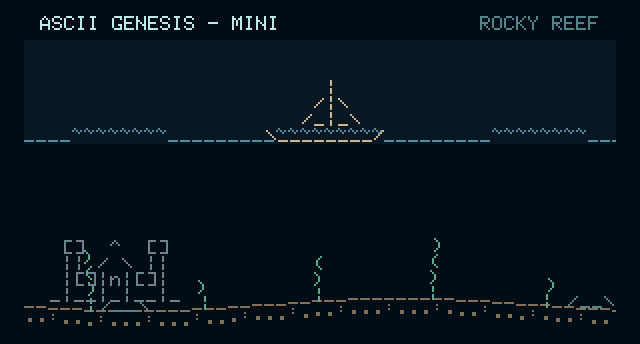
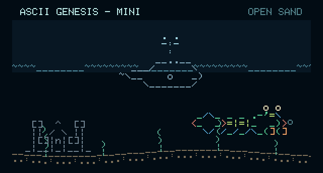
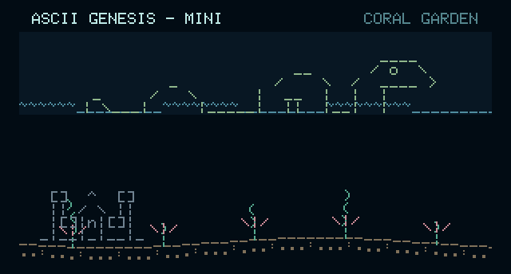
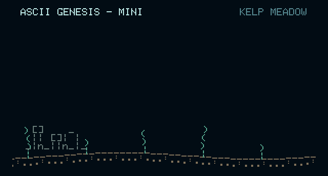

# Mini surface scenes and landmarks

Available in **Mini v0.1.11**. Update through **Settings → Check for Updates → Install**, keeping power connected through the restart and for at least thirty seconds afterward.

## Surface visits and landmarks

The journey occasionally rises to a visible waterline, then returns to deeper water. A surface stretch lasts about two minutes in a cycle of four to five minutes. The camera eases into and out of it over twelve seconds. A sailing boat, a surfacing whale with a short animated water spout, and a long-necked sea monster each get a thirty-second crossing window. Only one surface visitor appears at a time. Their order varies with the world seed; the creature parade keeps its original order.

Castles and submerged ruins belong to fixed world coordinates, so they move with the seabed. These new landmarks stay in the bottom third of the screen. They are background scenery rather than extra swimmers. The sea monster uses two poses adapted from the original Asciiquarium drawing; the compact boat, whale, spout, castle, and ruins are ASCII Genesis additions. See the repository credits for authors and licenses.

The surface visitors and landmarks are separate from the 28 regular creature and vehicle designs. They do not add entries to the parade. Pause freezes the scene; New World starts a new journey. During the parade, the surface scenes are hidden and their normal-world clock is held, then resumes afterward.

## Sailing boat

The boat sails along the waterline above the ordinary swimming bands.

## Surfacing whale

This is a separate compact visitor, in addition to the regular humpback whale drawing. It rises, briefly spouts water, and settles below the line as its crossing finishes. The spray is a short animation rather than a continuing stream of bubbles.

## Sea monster

The long neck and looping body use two poses. It is decorative and does not hunt.

## Submerged ruins

The Mini uses compact four-row castles and three-row ruins to leave open water above them. New landmarks stay within the bottom third. The seabed is not pulled upward during shallow stretches.

## Sparse bubbles and swimmer space

There are at most **two ordinary bubbles on screen**, shared by creatures and seabed emissions. Emission attempts are spaced **7–12 seconds** apart; an attempt can produce no bubble if both slots are occupied or the chosen creature is off screen. Bubbles rise at about seven logical pixels per second, drift gently, and disappear at the current waterline. They are hidden during the parade.

There are up to three ordinary swimmers, subject to drawing height and available space. As the waterline enters the view, swimmers are fitted into clear underwater bands. A slot is cleared if its drawing cannot fit, and new arrivals wait for enough room. The three surface visitors use their own single visitor slot.

## Preview and checks

These SVGs come from the actual Mini browser renderer and bundled bitmap font. They show selected moments with a landmark positioned in view; startup is randomized. They are software illustrations, not physical-board photographs.

Run `node tools/build-scenes-tour.mjs` to regenerate them, or add `--check` to detect stale illustrations. The preview checks exercise six ten-minute runs, all three visitors, deep/shallow transitions, the two-bubble cap, waterline disappearance, bottom-third landmark bounds, creature spacing, pause, and parade isolation. The firmware compiled and the public downloads were verified for this release; the new scenes have not yet been confirmed on the physical display.
