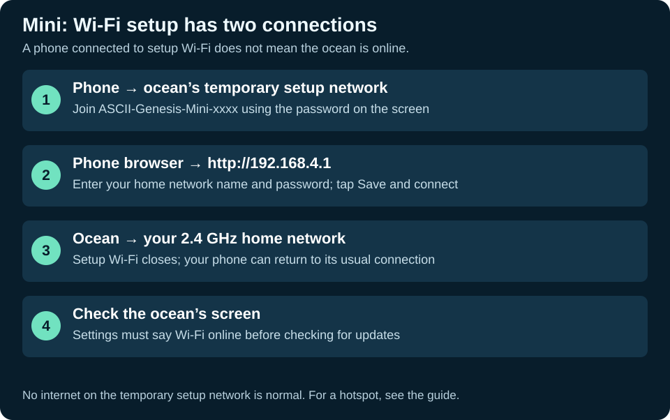

# Home Wi-Fi and phone hotspots

Wi-Fi is used for time synchronization and downloading firmware updates. The ocean works offline. The ESP32-S3 uses **2.4 GHz Wi-Fi**; a 5 GHz-only network will not work.

The phone and the ocean have separate connections. A phone showing “connected” is not the final check: look for **Wi-Fi online on the ocean’s Settings screen**.

## Connect with a phone

1. On the ocean, tap the water, then **Settings → Set up Wi-Fi with phone**.
2. The screen shows a temporary network named `ASCII-Genesis-Mini-xxxx` and its random password, both in large text.
3. On your phone, open Wi-Fi settings and join that exact network using the displayed password. This is the ocean's setup network, not your home Wi-Fi.
4. Choose **Stay connected** if your phone says there is no internet. The setup network is local and does not provide internet access.
5. In your phone's browser, type **http://192.168.4.1** into the address bar. Use `http`, not `https`, and do not enter it as a search query.
6. In the form, enter your **home network's name and password**. Match capitalization and spaces. Tap **Save and connect**.
7. The ocean saves those details and closes the temporary network. Your phone can return to its normal Wi-Fi.
8. Open ocean Settings. Look for **Wi-Fi online**. If it stays offline, check the details and repeat setup.

Setup closes after ten minutes, after successful submission, or when you tap Back. Reopening it creates a fresh setup password. Credentials are saved locally on the board; they are not sent to GitHub or the browser preview. The firmware does not enable flash encryption, so a person with physical access to the board may access saved settings.

## Use the same phone as a hotspot

Your phone may need to turn its hotspot off while it joins the ocean's setup network. That is okay: the board keeps retrying the saved network about every **15 seconds**.

1. Find your phone's hotspot **name and password** in its settings. Set the hotspot band to **2.4 GHz**. On supported iPhones, use **Maximize Compatibility**.
2. Join the ocean's setup network and open the form as described above.
3. Enter the **hotspot's** name and password, then tap Save and connect.
4. Turn on the phone's hotspot after the ocean closes its setup network.
5. Keep mobile data and the hotspot on. Allow about a minute for the board to retry and connect.
6. If necessary, leave the hotspot on and restart the ocean. Do not enter setup again unless the saved name/password needs changing.
7. Confirm Wi-Fi online, then use Check for updates.

If your phone has a setting to turn off the hotspot when no devices are connected, leave enough time for the board to join. A hotspot using only 5 GHz, an incorrect password, a data limit, or a carrier restriction can prevent updates.

## Time and internet access

On first connection, the board gets the date/time before making secure update requests. If it says **Clock not ready**, keep Wi-Fi/hotspot enabled, wait 1–2 minutes, then tap Check for updates again. Being connected to a router does not prove the router has internet access.

The firmware supports ordinary personal Wi-Fi and open networks. It does not implement enterprise username/certificate login or a hotel/cafe sign-in web page. Bluetooth update transfer is not implemented.

Phone settings: [Samsung hotspot guide](https://www.samsung.com/us/support/answer/ANS10002918/), [Apple hotspot compatibility](https://support.apple.com/en-ie/guide/security/secfd166f620/web).
